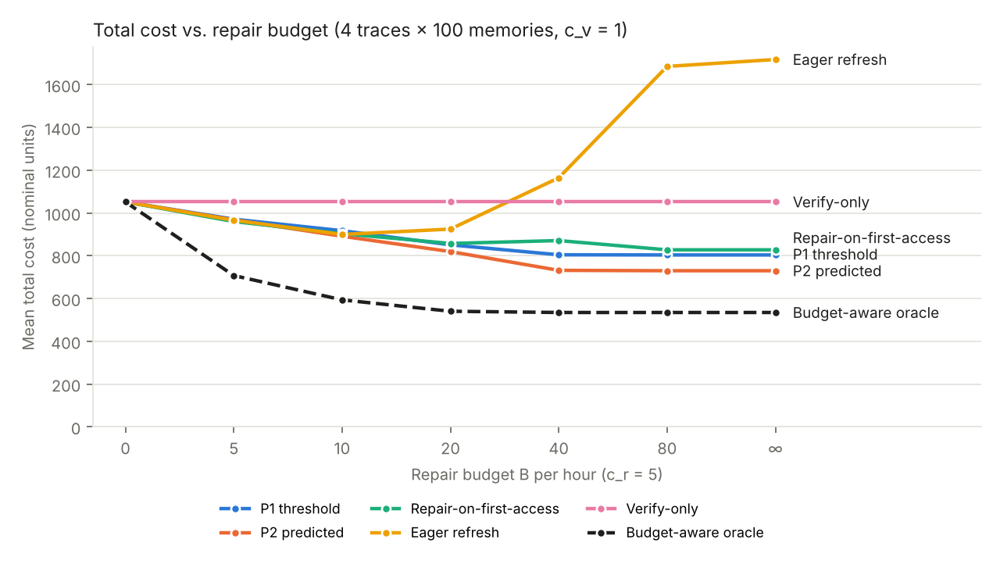

# Step 4: budget-aware hindsight oracle

Without a budget, the best possible cost for an episode is `min(k*c_v, c_r)`.
With a shared budget of `B` per window, the oracle can no longer repair every
episode that deserves it, so comparing budgeted policies against the unbudgeted
oracle would blame them for something no policy could do. `budget_oracle.py`
computes the best cost achievable **in hindsight under the same budget rules as
Step 3**.

## Formulation

For each episode `e` and each budget window `w` that overlaps it:

* the candidate repair instant is `t = max(start of e, start of w)` (repairing
  earlier within a window never hurts, and the engine realizes this instant
  because deferred repairs drain at the first event of each window);
* savings `s(e, w) = q * (queries of e at or after t) - c_r`, with
  `q = c_v` (or `min(c_v, λ)` for stale-use policies);
* only options with `s > 0` are kept.

Choose at most one window per episode and at most `floor(B / c_r)` repairs per
window, maximizing total savings. Oracle cost = `sum_e q*k_e - savings`.

* **Repeated corrections / repairs that lose value:** savings only count
  queries before the episode's next source change, so a repair deferred past
  that change is worth nothing.
* **Cross-window effects:** a repair in window `w` covers the episode's queries
  in all later windows; windows are coupled only through "one repair per
  episode", which the constraints encode exactly.
* **Exactness:** this is a bipartite b-matching (episodes × windows). It is
  solved as a 0/1 integer program with HiGHS (`scipy.optimize.milp`). The
  constraint matrix is totally unimodular, so the solution is exact; the
  status and MIP gap are recorded (`budget_oracle_gap`). When no window is
  over capacity, every episode takes its best option and the solver is skipped.
* **Restrictions:** the reduction assumes every repair costs the same `c_r`.
  Variable measured costs (Step 6) turn this into a knapsack per window; the
  same integer program extends to that case.
* **Heuristic:** `--budget-oracle greedy-heuristic` assigns options by
  descending savings. It is a feasible schedule, so its cost is an **upper**
  bound on the optimum, not a lower bound, and rows say so in
  `budget_oracle_method`.

Stale-use semantics match Step 2 (`min(c_v, λ)` per query; relaxed 0 for expiry
episodes).

## Validation

`tests/test_budget_oracle.py`:

* agrees with an independent brute force (tries every candidate repair
  instant: episode start, each query, each window start) on 200 random tiny
  traces, including zero, tight, and unlimited budgets, short windows,
  temporary exceptions, and stale-use semantics;
* hand-built cases for zero demand, tight budgets, and a repair that loses its
  value before the next reset;
* unlimited budget equals the Step 2 oracle per episode; `B = 0` equals
  verify-everything;
* no policy's budgeted cost is ever below the budget oracle;
* greedy ≥ exact and is labeled a heuristic.

Scale (10K memories, 36K episodes, 52K options, `c_r = 5`): exact solve in about
8 s with MIP gap 0 for `B ∈ {50, 200, 1000}`; greedy took about 1.6 s and was
0.1–1.1% above optimal.

## Experiment columns

With `--budget` on synthetic-v2 traces, every row adds
`budget_oracle_method`, `budget_oracle_cost`, `budget_regret`,
`budget_cost_vs_oracle`, and `budget_oracle_gap`.

## Budget sweep (`budget-sweep.csv`, `budget_vs_cost.png`)

All 8 policies on the four saved 100-memory traces, `c_v = 1`, `c_r = 5`,
one-hour windows, `B ∈ {0, 5, 10, 20, 40, 80, ∞}`. Mean total cost:

| Policy | 0 | 5 | 10 | 20 | 40 | 80 | ∞ |
|---|---|---|---|---|---|---|---|
| **Budget-aware oracle** | 1052 | 707 | 594 | 540 | 534 | 534 | 534 |
| p2 | 1052 | 968 | 891 | 819 | 732 | 730 | 730 |
| p1 | 1052 | 971 | 917 | 851 | 804 | 804 | 804 |
| repair-on-first-access | 1052 | 960 | 903 | 857 | 871 | 828 | 828 |
| eager-refresh | 1052 | 966 | 900 | 924 | 1164 | 1685 | 1718 |
| verify-only | 1052 | 1052 | 1052 | 1052 | 1052 | 1052 | 1052 |



Reproduce:

```bash
for B in 0 5 10 20 40 80; do
  python -m verify_repair.cli run-experiment \
    --workload data/synthetic_v2/{stable,bursty,shifting,fanout}-100-seed1.json \
    --repair-costs 5 --budget $B --output sweep-$B.csv
done
python scripts/plot_budget_sweep.py budget-sweep.csv budget_vs_cost.png
```

## Observations (development data)

* The oracle gains most of its benefit by `B = 20` (two-thirds of a repair per
  memory per day here); beyond that the budget stops binding.
* **More budget can make a policy worse.** Eager refresh is cheapest at
  `B = 10` and gets steadily more expensive as `B` grows, because extra budget
  lets it repair summaries nobody asks about again. A tight budget plus the
  savings-ordered queue acts as a filter.
* Policies sit 1.37–1.63x above the budget-aware oracle under binding budgets,
  noticeably closer to it than to the unbudgeted oracle, which would have
  overstated their regret.
